# RepairFlow

**修理依頼・対応状況・作業履歴を一元管理する、ロール別権限管理対応の修理管理システム**

[](https://laravel.com/)
[](https://www.php.net/)
[](https://www.mysql.com/)
[](https://tailwindcss.com/)

## 1. アプリケーション概要

RepairFlowは、施設や設備の修理依頼から担当者の割り当て、対応状況の管理、修理履歴の記録までを一元管理するWebアプリケーションです。

依頼者・技術者・管理者の3つの役割に応じて利用できる機能を分け、修理依頼の受付から完了までの業務を管理できるように設計しました。

キャンセル申請と管理者による審査、操作履歴の記録、ユーザーの利用状態管理など、実際の業務運用を想定したルールを実装しています。

### 公開アプリケーション

- **アプリケーションURL：** https://repairflow-app.onrender.com/login
- **GitHub：** https://github.com/yuyu580905-dev/RepairFlow-app

## 2. アプリケーション画面

### ログイン画面

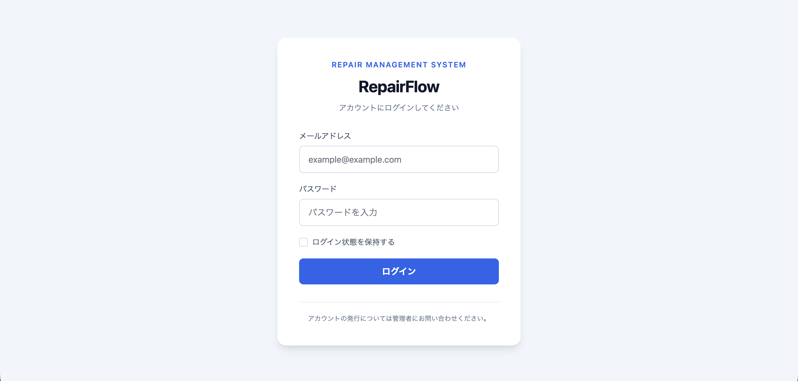

### 管理者ダッシュボード

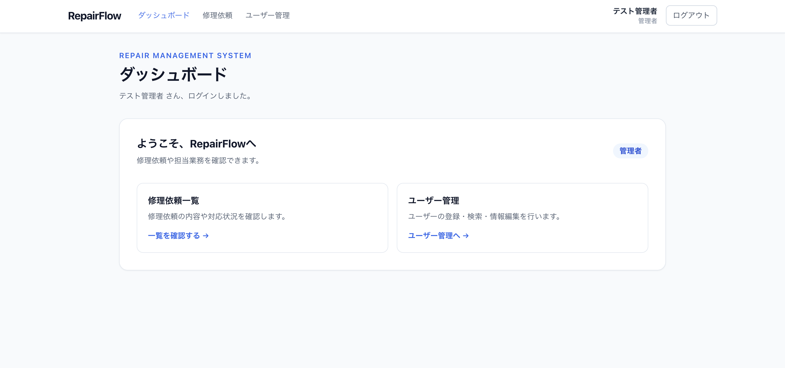

### 修理依頼一覧

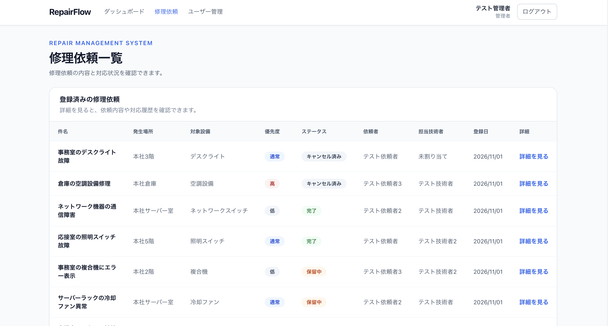

### 修理依頼詳細・対応履歴

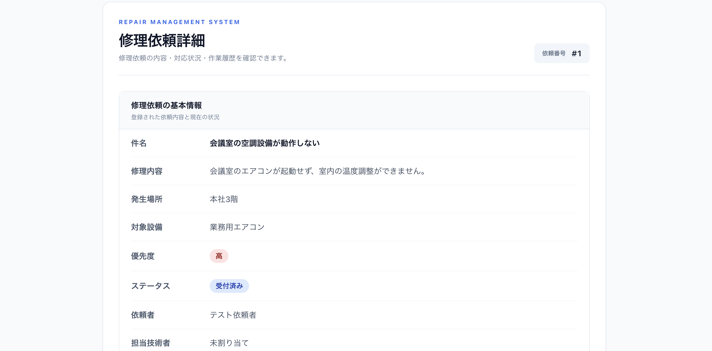

### キャンセル申請の審査

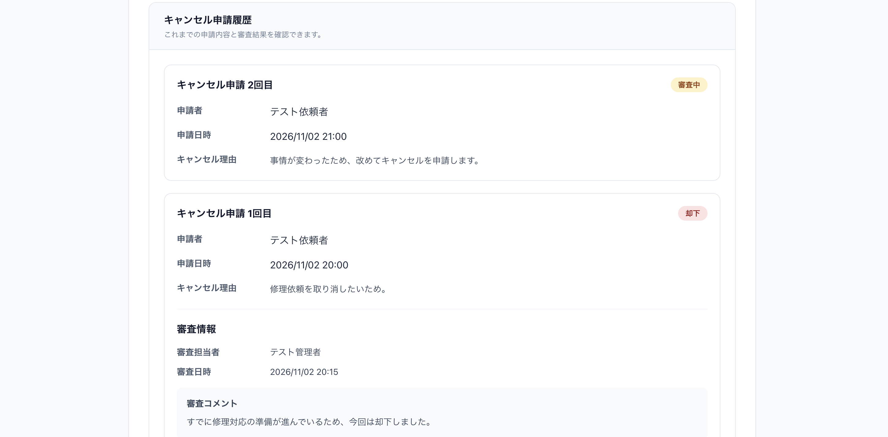

### 修理履歴

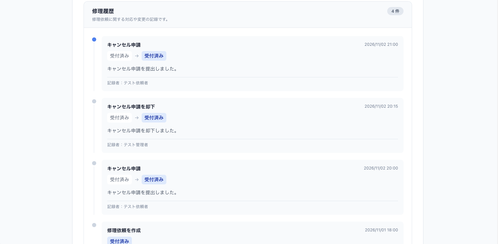

### ユーザー管理

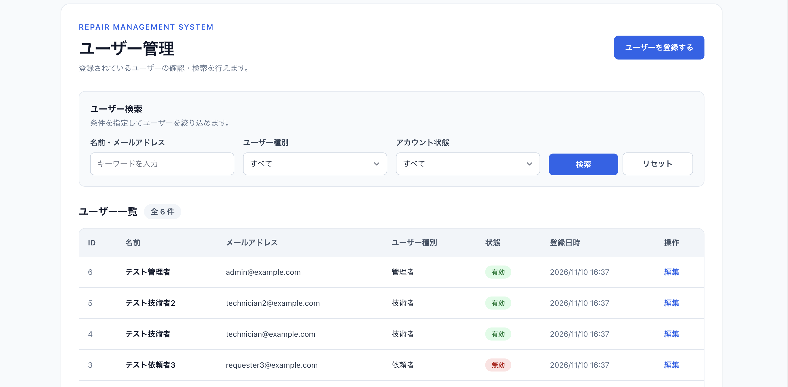

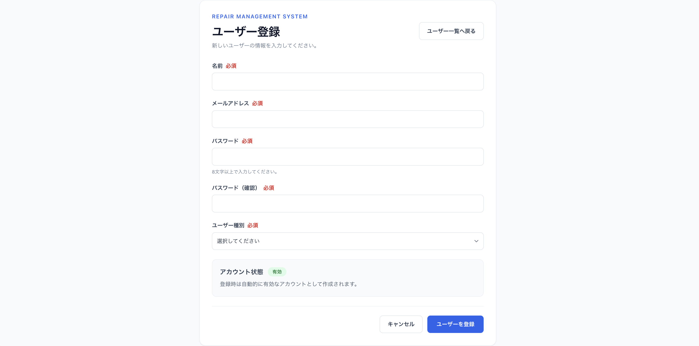

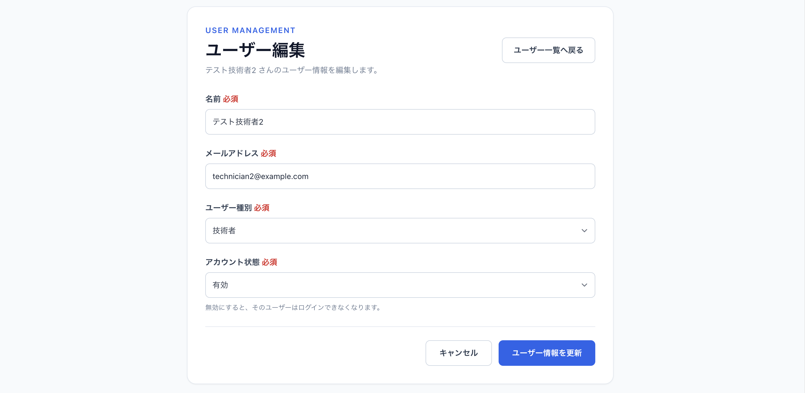

### 依頼者ダッシュボード

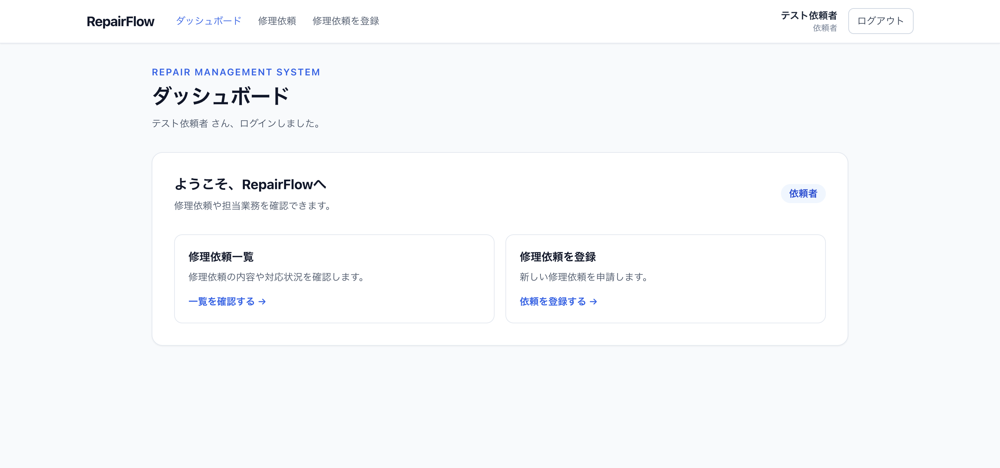

### スマートフォン表示

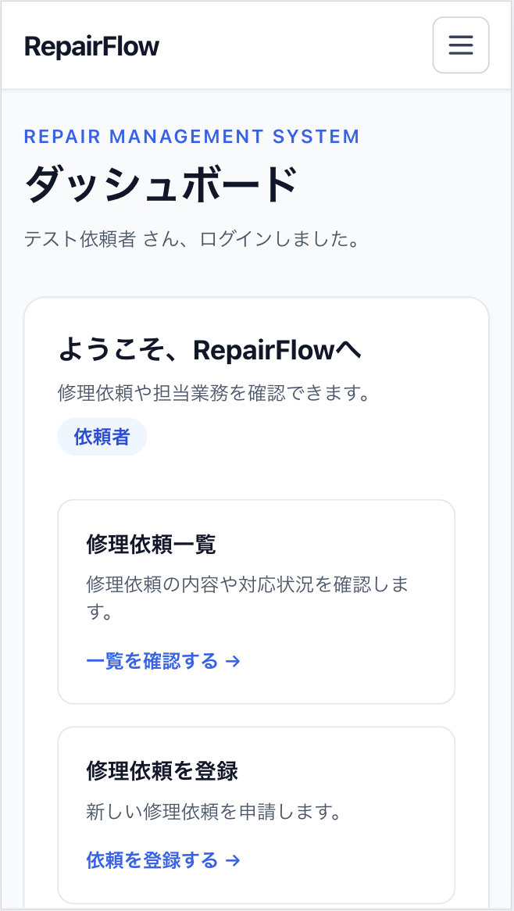

## 3. 主な機能

RepairFlowでは、ユーザーの役割に応じて操作できる機能を制御しています。

| 機能                       | 依頼者 | 技術者 | 管理者 |
| -------------------------- | :----: | :----: | :----: |
| 修理依頼一覧・詳細の閲覧   |   ○    |   ○    |   ○    |
| 修理依頼の新規登録         |   ○    |   -    |   -    |
| 担当修理依頼の対応状況更新 |   -    |   ○    |   -    |
| 修理依頼への技術者割り当て |   -    |   -    |   ○    |
| キャンセル申請             |   ○    |   -    |   -    |
| キャンセル申請の審査       |   -    |   -    |   ○    |
| 修理履歴の閲覧             |   ○    |   ○    |   ○    |
| ユーザー管理               |   -    |   -    |   ○    |

### 依頼者

- 修理依頼の新規登録
- 自分が登録した修理依頼の一覧・詳細確認
- 受付済みの修理依頼に対するキャンセル申請
- キャンセル申請の審査状況確認
- 修理対応履歴の確認

### 技術者

- 自分が担当する修理依頼の確認
- 担当修理依頼の対応状況更新
- 修理対応履歴の確認

### 管理者

- 修理依頼の一覧・詳細確認
- 有効な技術者への担当割り当て
- キャンセル申請の承認・却下
- ユーザーの一覧・検索
- ユーザーの新規登録・編集

## 4. 業務ルール・設計上の工夫

実際の業務で発生する操作やデータの整合性を考慮し、以下のルールを実装しています。

### 4-1. ロールに応じた権限制御

ユーザーの役割を以下の3種類に分けています。

- `requester`：依頼者
- `technician`：技術者
- `admin`：管理者

各機能でPolicyによる認可制御を行い、権限のないユーザーによる操作を防止しています。

また、ユーザー自身による新規登録機能は設けず、管理者がユーザーを作成する運用としています。

### 4-2. ユーザーの利用状態管理

ユーザーごとに有効・無効の状態を管理しています。

- 無効化されたユーザーはログインできない
- 最後の有効な管理者は無効化できない
- 最後の有効な管理者は管理者以外のロールへ変更できない
- 対応中の修理依頼を担当している技術者は、無効化やロール変更をできない

ユーザー管理では、複数の管理者による同時操作も考慮し、トランザクションと行ロックを利用してデータの整合性を保つようにしています。

### 4-3. 修理依頼と担当技術者の管理

- 修理依頼は依頼者本人が登録する
- 登録時のステータスは「受付済み」
- 担当技術者は管理者が割り当てる
- 割り当て対象は有効な技術者に限定する
- 技術者は自分が担当する修理依頼の対応状況を更新する

### 4-4. キャンセル申請・審査

修理依頼のキャンセルは、依頼者が直接ステータスを変更するのではなく、申請と管理者による審査を経て処理する設計にしています。

- 依頼者は自分の受付済み修理依頼に対して申請できる
- 管理者は申請を承認または却下できる
- 承認された場合、修理依頼のステータスをキャンセル済みに変更する
- 却下された場合、修理依頼のステータスは変更しない
- 却下後に再申請された場合も、過去の申請レコードを保持する

これにより、キャンセルに関する判断経緯を後から確認できます。

### 4-5. 修理履歴の追記型管理

修理依頼の作成、担当者の割り当て、ステータス変更、キャンセル申請・審査などの操作を修理履歴として記録します。

修理履歴は既存レコードを更新・削除するのではなく、新しいレコードを追加する方式で管理しています。

過去の操作記録を保持することで、修理依頼ごとの対応経緯を時系列で追跡できます。

### 4-6. データベースの整合性

- 外部キー制約によるテーブル間の関連性の保証
- 外部キーの削除時動作に `RESTRICT` を設定
- 検索条件を考慮した複合インデックスの設定
- FormRequestによる入力値・状態遷移のバリデーション
- トランザクションと行ロックによる同時更新への対策

特に、修理履歴やキャンセル申請履歴が関連データの削除によって失われないようにしています。

## 5. データベース設計

RepairFlowでは、主に以下の4つの業務テーブルを使用しています。

| テーブル                | 役割                           |
| ----------------------- | ------------------------------ |
| `users`                 | ユーザー情報・権限・利用状態   |
| `repair_requests`       | 修理依頼情報・担当者・対応状況 |
| `repair_logs`           | 修理対応・操作履歴             |
| `cancellation_requests` | キャンセル申請・審査履歴       |

### ER図

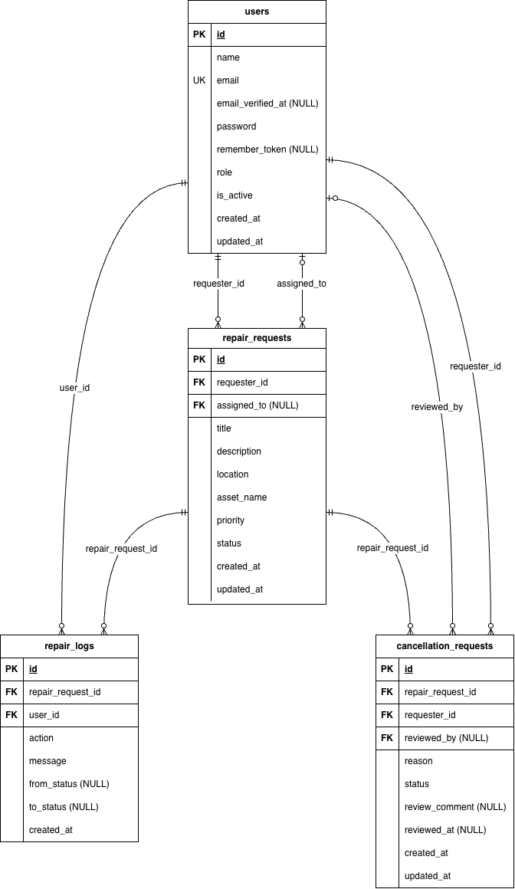

詳細なカラム定義、外部キー、インデックス、設計方針については、以下の資料を参照してください。

- [データベース設計書](docs/database-design.md)
- [ER図（draw.io）](er-diagram.drawio)

## 6. 使用技術

### バックエンド

| 技術            | バージョン・用途                   |
| --------------- | ---------------------------------- |
| PHP             | 8.3.36                             |
| Laravel         | 10.50.3                            |
| Laravel Fortify | ログイン認証                       |
| Laravel Sanctum | API認証                            |
| Eloquent ORM    | データベース操作・リレーション管理 |

### フロントエンド

| 技術         | バージョン・用途 |
| ------------ | ---------------- |
| Tailwind CSS | 3.4.19           |
| Alpine.js    | 3.17.5           |
| Vite         | 5.4.21           |
| Node.js      | 24.22.3          |
| npm          | 12.2.2           |

### データベース・開発環境

| 技術         | バージョン・用途                   |
| ------------ | ---------------------------------- |
| MySQL        | 8.4.11・ローカル開発用データベース |
| Laravel Sail | Dockerベースの開発環境             |
| Docker       | コンテナ環境                       |
| phpMyAdmin   | ローカル開発用データベース管理     |

### 本番環境

| 技術       | 用途                                     |
| ---------- | ---------------------------------------- |
| Render     | アプリケーションの公開・実行             |
| TiDB Cloud | MySQL Compatibleモードの本番データベース |
| Docker     | 本番アプリケーションのコンテナ化         |

## 7. ローカル環境構築

### 動作確認済みの開発環境

- PHP 8.3.36（コンテナ内）
- Laravel 10.50.3
- MySQL 8.4.11
- Node.js 24.22.3
- npm 12.2.2
- Docker / Laravel Sail

### 前提条件

以下をインストールしてください。

- Git
- Docker Desktop
- Composer

### 1. リポジトリをクローン

```bash
git clone https://github.com/yuyu580905-dev/RepairFlow-app.git
cd RepairFlow-app
```

### 2. Composerパッケージをインストール

```bash
composer install
```

### 3. 環境設定ファイルを作成

```bash
cp .env.example .env
```

`.env.example` にはLaravel Sail用のデータベース接続設定を記載しています。

- `DB_HOST=mysql`
- `DB_USERNAME=sail`
- `DB_PASSWORD=password`

`DB_HOST=mysql` は、SailのDockerネットワーク内でMySQLコンテナに接続するための設定です。

必要に応じて、`.env` のアプリケーション設定やデータベース接続設定を環境に合わせて変更してください。

※ `.env` には環境固有の設定や認証情報を記載します。実際の認証情報をGitHubなどに公開しないでください。

### 4. Dockerコンテナを起動

```bash
./vendor/bin/sail up -d
```

### 5. アプリケーションキーを生成

```bash
./vendor/bin/sail artisan key:generate
```

### 6. データベースのマイグレーションと初期データ登録

```bash
./vendor/bin/sail artisan migrate --seed
```

初期データとして、ユーザー・修理依頼・キャンセル申請・修理履歴が登録されます。

### 7. フロントエンドパッケージをインストール

```bash
./vendor/bin/sail npm install
```

### 8. フロントエンドアセットをビルド

```bash
./vendor/bin/sail npm run build
```

### 9. アプリケーションへアクセス

- **Laravel：** http://localhost
- **phpMyAdmin：** http://localhost:8080

開発中にViteの開発サーバーを利用する場合は、以下を実行してください。

```bash
./vendor/bin/sail npm run dev
```

### コンテナの停止

```bash
./vendor/bin/sail down
```

## 8. ローカル開発用デモアカウント

`DatabaseSeeder` により、以下の6ユーザーが作成されます。

| 役割   | メールアドレス          | パスワード |
| ------ | ----------------------- | ---------- |
| 管理者 | admin@example.com       | password   |
| 技術者 | technician@example.com  | password   |
| 技術者 | technician2@example.com | password   |
| 依頼者 | requester@example.com   | password   |
| 依頼者 | requester2@example.com  | password   |
| 依頼者 | requester3@example.com  | password   |

**注意：** これらはローカル開発・デモデータ用のアカウントです。本番環境のログイン情報として利用できることを示すものではありません。

## 9. テスト・コード品質

機能ごとにFeatureテストを作成し、認証・認可、修理依頼の登録・更新、担当者割り当て、キャンセル申請・審査、ユーザー管理などの動作を検証しています。

### テスト実行

```bash
./vendor/bin/sail artisan test
```

### Laravel Pintによるコードスタイル確認

```bash
./vendor/bin/sail bin pint --test
```

### フロントエンドのビルド確認

```bash
./vendor/bin/sail npm run build
```

### 確認済みテスト結果

- **Feature / Unit Tests：** 119 passed
- **Assertions：** 380

## 10. 本番環境・デプロイ構成

本番環境では、Render上でDockerコンテナを利用してLaravelアプリケーションを実行し、データベースにはTiDB Cloudを採用しています。

TiDB CloudはMySQL Compatibleモードで構築し、LaravelからMySQL接続方式で利用しています。

### 構成イメージ

```text
              Web Browser
                   |
                   v
                Render
             Docker Container
                   |
                   v
          Laravel Application
                   |
                   v
               TiDB Cloud
           MySQL Compatible
```

Dockerfileでは、Node.jsによるフロントエンドアセットのビルドと、PHP 8.3 / ApacheによるLaravelアプリケーションの実行環境を構築しています。

ローカル開発環境と本番環境でデータベースを分けることで、開発・テストと公開環境を分離しています。

## 11. 制作者

**GitHub：** [yuyu580905-dev](https://github.com/yuyu580905-dev)

**Repository：** [RepairFlow-app](https://github.com/yuyu580905-dev/RepairFlow-app)
